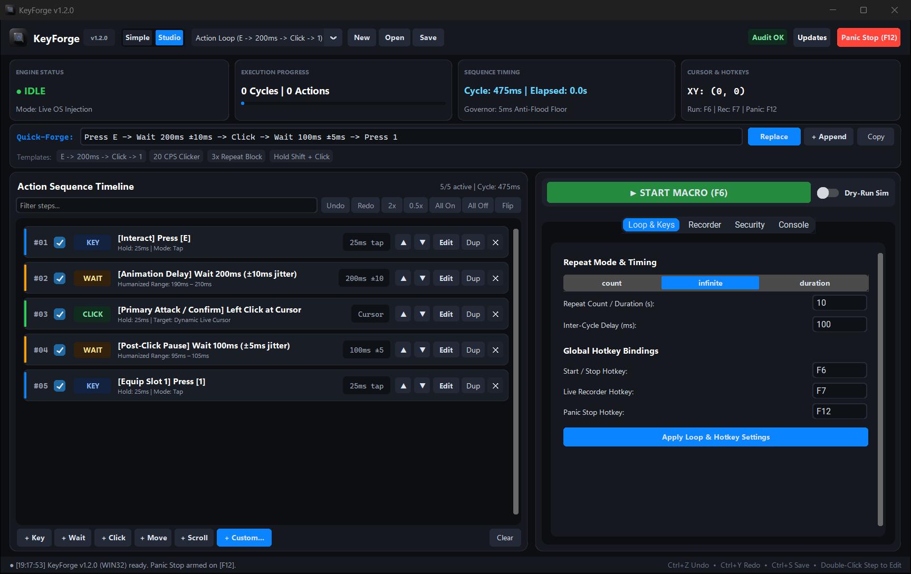
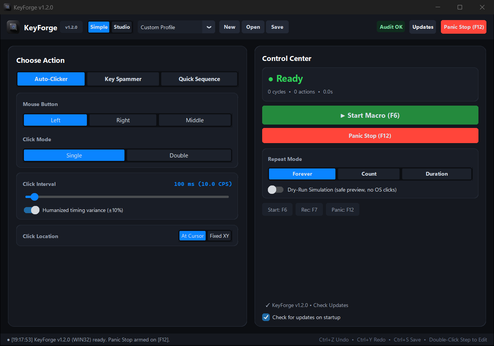
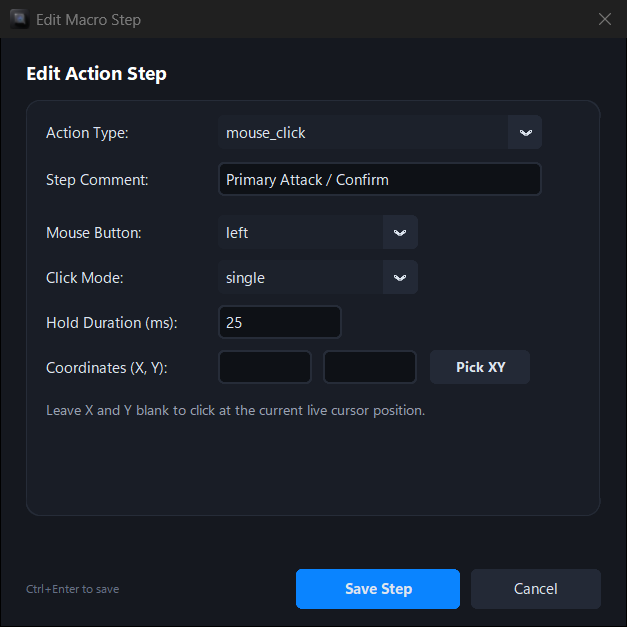
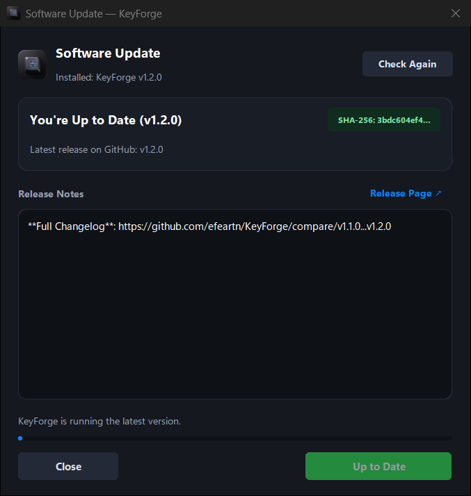
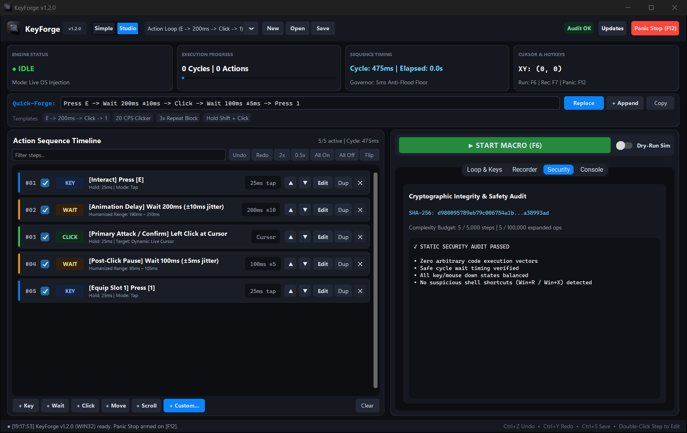
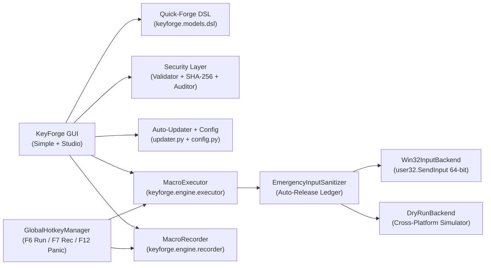

<div align="center">


# KeyForge

**Minimalist Dark Titanium Keyboard & Mouse Macro Studio, Auto-Clicker & Input Recorder.**  
Free, Open-Source (`GPL-3.0`), Cybersecurity-Hardened, and Native for Windows, macOS & Linux — with Zero Browser Bloat.

[](https://github.com/efeartn/KeyForge/actions/workflows/ci.yml)
[](https://github.com/efeartn/KeyForge/releases/latest)
[](https://github.com/efeartn/KeyForge/releases/latest)
[](pyproject.toml)
[](SECURITY.md)
[](LICENSE)

[**Download v1.2.0**](#download-standalone-executables) • [**Visual Tour**](#visual-tour) • [**Auto-Updater & Config**](#auto-updater--persistent-configuration) • [**Quick-Forge DSL**](#quick-forge-recipe-dsl-reference) • [**Cybersecurity**](#cybersecurity--safety-engineering) • [**CLI & Source**](#installation--quick-start)

</div>

---

## Studio Workspace at a Glance

<div align="center">
  
  <br />
  <sub><b>Studio Mode</b> — Bento execution telemetry strip, live Quick-Forge DSL bar, color-coded visual timeline cards, repeat/hotkey inspector, and hardware Panic Stop (<code>F12</code>).</sub>
</div>

---

## Visual Tour

### Dual Workspaces: `Simple` & `Studio`

KeyForge adapts smoothly from beginner one-click automation to full multi-step macro engineering without forcing complex timelines onto everyday users.

<table>
  <tr>
    <td width="58%" valign="top">
      
    </td>
    <td width="42%" valign="top">
      <h3>Everyday Automation in One Screen</h3>
      <ul>
        <li><b>Two Live Modes:</b> Toggle between <b>Simple</b> (Auto-Clicker, Key Spammer, Quick Sequence) and <b>Studio</b> (full visual timeline) with live bidirectional profile syncing.</li>
        <li><b>Humanized Precision:</b> Toggle <code>±10%</code> random timing variance directly from Simple Mode so automated clicks and keystrokes never look robotic.</li>
        <li><b>Built for Older &amp; Low-RAM PCs:</b> Native <code>CustomTkinter</code> + <code>Pillow</code> UI with zero Chromium/WebView runtime overhead and responsive <code>1280×720</code> High-DPI sizing.</li>
        <li><b>Zero Guesswork Controls:</b> Clear Start (<code>F6</code>), Panic Stop (<code>F12</code>), Dry-Run Simulation toggle, and startup update toggle.</li>
      </ul>
    </td>
  </tr>
</table>

### Modal Step Editor & Cryptographic In-App Updater

<table>
  <tr>
    <td width="50%" valign="top" align="center">
      
      <p align="left">
        <b>Precision Step Inspector</b><br />
        Double-click any step (or click <code>Edit</code>) to configure key holds, click modes, relative pixel deltas, nested <code>Repeat</code> loops, or capture live cursor coordinates with <b>Pick XY</b>.
      </p>
    </td>
    <td width="50%" valign="top" align="center">
      
      <p align="left">
        <b>Startup Check &amp; SHA-256 Auto-Updater</b><br />
        Checks GitHub Releases cleanly on launch, displays release notes and SHA-256 status, verifies downloads via <code>SHA256SUMS.txt</code> (<code>hmac.compare_digest</code>), and upgrades binaries in-place while keeping every setting and macro intact.
      </p>
    </td>
  </tr>
</table>

### Built-In Static Security Audit & Integrity Verification

<div align="center">
  
  <br />
  <sub><b>Live Security Inspector Tab</b> — Displays the active profile's canonical <code>SHA-256</code> integrity digest, complexity budget counters, and real-time <code>KF-SEC-001..005</code> static safety checks.</sub>
</div>

---

## Download Standalone Executables

Every tagged release is compiled, tested on Python 3.11–3.13 across all OS targets, and published by [GitHub Actions](https://github.com/efeartn/KeyForge/actions) alongside individual checksums and a combined [`SHA256SUMS.txt`](https://github.com/efeartn/KeyForge/releases/latest/download/SHA256SUMS.txt):

| Operating System | Architecture | Standalone Binary | Checksum Manifest |
| :--- | :--- | :--- | :--- |
| **Windows 10 / 11** | `x64` | [**`KeyForge-Windows-x64.exe`**](https://github.com/efeartn/KeyForge/releases/latest/download/KeyForge-Windows-x64.exe) | [`KeyForge-Windows-x64.exe.sha256.txt`](https://github.com/efeartn/KeyForge/releases/latest/download/KeyForge-Windows-x64.exe.sha256.txt) |
| **macOS** | `Apple Silicon (arm64)` | [**`KeyForge-macOS-arm64`**](https://github.com/efeartn/KeyForge/releases/latest/download/KeyForge-macOS-arm64) | [`KeyForge-macOS-arm64.sha256.txt`](https://github.com/efeartn/KeyForge/releases/latest/download/KeyForge-macOS-arm64.sha256.txt) |
| **Linux** | `x86_64` | [**`KeyForge-Linux-x64`**](https://github.com/efeartn/KeyForge/releases/latest/download/KeyForge-Linux-x64) | [`KeyForge-Linux-x64.sha256.txt`](https://github.com/efeartn/KeyForge/releases/latest/download/KeyForge-Linux-x64.sha256.txt) |

<details>
<summary><b>Verify Binary Checksum Before Running (Optional)</b></summary>

```powershell
# Windows (PowerShell)
Get-FileHash .\KeyForge-Windows-x64.exe -Algorithm SHA256
```

```bash
# macOS
shasum -a 256 KeyForge-macOS-arm64 && chmod +x KeyForge-macOS-arm64

# Linux
sha256sum -c KeyForge-Linux-x64.sha256.txt && chmod +x KeyForge-Linux-x64
```

</details>

---

## Auto-Updater & Persistent Configuration

When you upgrade KeyForge from inside the app or launch a newer standalone binary, your hotkeys, UI mode, Auto-Clicker / Key Spammer sliders, window geometry, and active macro profile stay completely intact.

- **Startup Release Check**: Background check on startup notifies you cleanly via a dismissible header banner and the **Updates** pill when a newer release exists on GitHub (can be toggled anytime with **Check for updates on startup**).
- **Strict Transport & Hash Verification**: Enforces `HTTPS`-only GitHub redirects, matches binaries to the host OS/architecture, streams downloads atomically with progress reporting, and rejects any download whose `SHA-256` fails constant-time comparison against `SHA256SUMS.txt` / `.sha256.txt`.
- **Safe Executable Hot-Swap & Rollback**: Stages upgrades safely without touching your user config folder; on Windows a lightweight swapper waits for process exit, preserves a rollback copy until launch succeeds, and restarts cleanly.
- **Crash-Safe Config & Profile Storage** (atomic `fsync` + `.bak` fallback; overridable via `KEYFORGE_CONFIG_DIR`):

| Platform | Configuration Directory | Stored Files |
| :--- | :--- | :--- |
| **Windows** | `%APPDATA%\KeyForge` | `config.json`, `active_profile.kfmacro.json` (+ `.bak`) |
| **macOS** | `~/Library/Application Support/KeyForge` | `config.json`, `active_profile.kfmacro.json` (+ `.bak`) |
| **Linux / BSD** | `$XDG_CONFIG_HOME/KeyForge` (or `~/.config/KeyForge`) | `config.json`, `active_profile.kfmacro.json` (+ `.bak`) |

---

## Why KeyForge?

Many desktop macro tools force a trade-off between usability, transparency, and safety:

| Feature / Guarantee | **KeyForge (`GPL-3.0`)** | **TinyTask** | **AutoHotkey** | **Paid Macro Tools** |
| :--- | :---: | :---: | :---: | :---: |
| **100% Free & Open Source** | ✅ Yes | ❌ Closed binary | ✅ Yes | ❌ Paywalls / Trials |
| **Beginner Auto-Clicker + Visual Studio** | ✅ Dual UI Modes | ❌ Record-only blob | ❌ Scripts only | ⚠️ Often split tiers |
| **One-Line Quick-Forge Recipe Bar** | ✅ `Press E -> Wait 200ms -> Click` | ❌ No | ❌ Manual script | ❌ No |
| **Humanized Random Jitter (`±ms`)** | ✅ Built into Wait steps | ❌ Fixed delays | ⚠️ Manual `Random()` | ❌ Rare |
| **Auto-Release Stuck Keys on Abort** | ✅ `EmergencyInputSanitizer` | ❌ Leaves Shift/Ctrl stuck | ❌ Manual cleanup | ⚠️ Unreliable |
| **SHA-256 Signed Profiles + Static Auditor** | ✅ Yes (`KF-SEC-001..005`) | ❌ Unverified binary blobs | ❌ Arbitrary execution | ❌ Closed format |
| **In-App Verified Updater + Config Sync** | ✅ HTTPS + SHA-256 | ❌ None | ⚠️ External installer | ⚠️ Telemetry-heavy |
| **Cross-Platform Native Binaries** | ✅ Windows, macOS & Linux | ⚠️ Windows only | ⚠️ Windows only | ⚠️ Windows only |

---

## Quick-Forge Recipe DSL Reference

Type or paste human-readable macro recipes directly into the **Quick-Forge** bar and press `Enter` (or click **Replace** / **+ Append**):

| Action | Quick-Forge Syntax Examples | Description |
| :--- | :--- | :--- |
| **Key Tap** | `Press E` • `Press Space` • `Press 1 (hold 40ms)` | Presses and releases a key with configurable hold time |
| **Modifier Combo** | `Press Ctrl+Shift+E` • `Press Alt+F` | Holds modifiers in order, taps primary key, releases in reverse |
| **Key Hold / Release** | `KeyDown Shift` • `KeyUp Shift` | Explicit key state transitions (auto-sanitized on stop) |
| **Mouse Click** | `Click` • `Click Right` • `DoubleClick Left at (640, 480)` | Single, double, down, or up click at live cursor or fixed `(X, Y)` |
| **Mouse Move** | `Move (500, 500)` • `Move (+120, -40) rel` | Absolute screen coordinates or relative pixel delta |
| **Mouse Scroll** | `Scroll -3` • `Scroll +5` | Vertical (`+Up` / `-Down`) mouse wheel scrolling |
| **Wait + Jitter** | `Wait 200ms` • `Wait 150ms ±20ms` • `Wait 1.5s` | High-precision interruptible sleep with optional humanization jitter |
| **Nested Repeat** | `Repeat 3 { Press F -> Wait 120ms ±15ms } -> Click` | Repeats an inner sequence `N` times inside the main macro loop |

### Live Input Recorder (`F7`) & Hardware Panic Kill-Switch (`F12`)

- **Live Recorder (`F7`)**: Records real-time keyboard and mouse inputs into editable timeline cards, automatically coalesces `KeyDown + KeyUp` taps, and filters out KeyForge's own `0x4B465247` (`"KFRG"`) synthetic injection marker and active hotkeys.
- **Panic Kill-Switch (`F12`)**: Interrupts running macros immediately — even mid-`Wait` — and invokes **`EmergencyInputSanitizer`** to dispatch matching `KeyUp` / `MouseUp` events in reverse order so `Shift`, `Ctrl`, or mouse buttons never stay stuck down.

---

## Cybersecurity & Safety Engineering

KeyForge is built with defensive local and supply-chain safeguards documented in [`SECURITY.md`](SECURITY.md):

1. **Declarative JSON Profiles (Zero `eval` / `exec` / `pickle`)**: `.kfmacro.json` files validate strictly against allowlists, bounds, and types in [`keyforge/security/validator.py`](keyforge/security/validator.py), rejecting `NaN`/`Infinity`, boolean-as-integer confusion, path traversal, NTFS ADS (`:`), and reserved device names (`CON`, `NUL`, `COM1`).
2. **Canonical `SHA-256` Signing**: Profiles embed an `integrity_sha256` digest verified via constant-time `hmac.compare_digest` in [`keyforge/security/integrity.py`](keyforge/security/integrity.py).
3. **Anti-DoS Complexity Budgets**: Caps `MAX_PROFILE_FILE_BYTES = 1 MiB`, `MAX_TOTAL_STEPS = 5,000`, `MAX_NESTING_DEPTH = 5`, `MAX_EXPANDED_OPS_PER_CYCLE = 100,000`, plus a `5ms` minimum inter-cycle flood governor.
4. **Built-In Static Security Auditor ([`keyforge/security/auditor.py`](keyforge/security/auditor.py))**:

| Rule Code | Severity | Security & Safety Check |
| :--- | :--- | :--- |
| **`KF-SEC-001`** | `WARNING` | Detects zero-wait infinite loops and confirms the `5ms` anti-flood governor is active |
| **`KF-SEC-002`** | `WARNING` | Detects unbalanced `KeyDown` / `MouseDown` actions without matching release steps |
| **`KF-SEC-003`** | `CRITICAL` | Flags suspicious shell/system shortcuts (`Win+R`, `Win+X`, `Alt+F4`), including split `KeyDown RWin -> Press R` sequences |
| **`KF-SEC-004`** | `WARNING` | Flags extreme mouse click rates (`> 100 CPS`) |
| **`KF-SEC-005`** | `WARNING` | Flags empty sequences or profiles where every step is disabled |

---

## Architecture & Repository Layout



```text
KeyForge/
├── .github/workflows/ci.yml      # Multi-OS Test, Audit, PyInstaller Build & Release Pipeline
├── docs/screenshots/             # README Desktop Interface & Dialog Screenshots
├── keyforge/
│   ├── assets/                   # Bundled App Icon Assets (icon.png, icon.ico)
│   ├── engine/
│   │   ├── backend.py            # InputBackend ABC, DryRunBackend & EmergencyInputSanitizer
│   │   ├── executor.py           # Interruptible MacroExecutor & Live Telemetry
│   │   ├── hotkeys.py            # Global Hotkey Polling Thread (F6 / F7 / F12)
│   │   ├── recorder.py           # Live Input Recorder with Tap Coalescing & Self-Filter
│   │   └── win32_input.py        # 64-bit Win32 SendInput + Cross-Platform Fallback
│   ├── models/
│   │   ├── action.py             # MacroAction Dataclass, ActionType & Validation
│   │   ├── dsl.py                # Quick-Forge Recipe Parser & Formatter
│   │   ├── keymap.py             # Virtual-Key (VK) & Hardware Scan-Code Registry
│   │   └── profile.py            # MacroProfile & Built-In Presets
│   ├── security/
│   │   ├── auditor.py            # Static Security & Safety Analyzer (KF-SEC-001..005)
│   │   ├── integrity.py          # Canonical SHA-256 Signing & Constant-Time Verification
│   │   └── validator.py          # Allowlist Schema, Path & Complexity Budget Validator
│   ├── ui/
│   │   ├── app.py                # Dual Simple/Studio Dark Titanium Desktop GUI
│   │   ├── step_dialog.py        # Modal Step Inspector with Live Pick XY Capture
│   │   ├── theme.py              # Dark Titanium Palette, High-DPI & Window Helpers
│   │   └── update_dialog.py      # SHA-256 Verified GitHub Releases Update Sheet
│   ├── config.py                 # Crash-Safe AppData/XDG Config & Active Profile Persistence
│   ├── main.py                   # CLI & Desktop GUI Entry Point
│   └── updater.py                # SemVer Client, SHA-256 Verifier & Atomic Hot-Swapper
├── scripts/build_exe.py          # Cross-Platform PyInstaller Compiler + SHA-256 Generator
└── tests/                        # Unit, Security, Updater, Config, Engine, CLI & UI Tests
```

---

## Installation & Quick Start

### Run from Source

```bash
git clone https://github.com/efeartn/KeyForge.git
cd KeyForge
pip install -e ".[dev]"

# Launch KeyForge Desktop GUI
python -m keyforge
```

### Command-Line Interface (CLI)

```bash
# Check installed version
python -m keyforge --version

# Simulate a Quick-Forge recipe in safe Dry-Run mode (no live OS inputs)
python -m keyforge --expr "Press E -> Wait 200ms -> Click -> Press 1" --repeat 3 --dry-run

# Export the signed starter profile
python -m keyforge --export-default my_combo.kfmacro.json

# Run the static security & safety audit on a saved profile
python -m keyforge --profile my_combo.kfmacro.json --audit

# Execute a saved profile with live OS injection
python -m keyforge --profile my_combo.kfmacro.json
```

### Compile a Standalone Binary & Run Tests

```bash
# Build single-file executable + .sha256.txt manifest under dist/
pip install pyinstaller
python scripts/build_exe.py

# Run test suite, coverage, lint & formatting checks
python -m pytest --cov=keyforge --cov-report=term-missing
python -m ruff check keyforge tests scripts
python -m ruff format --check keyforge tests scripts
```

---

## License & Security Policy

- **License**: Distributed under the [**GNU General Public License v3.0**](LICENSE).
- **Security Policy**: See [**SECURITY.md**](SECURITY.md) for architecture threat models, auto-updater verification details, and vulnerability disclosure guidelines.
