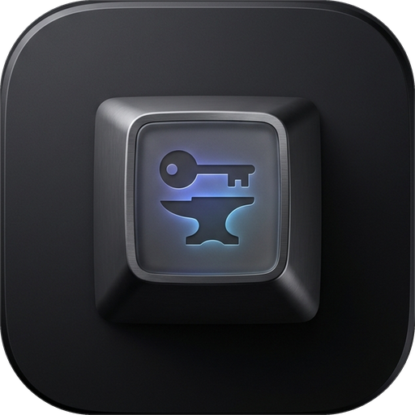
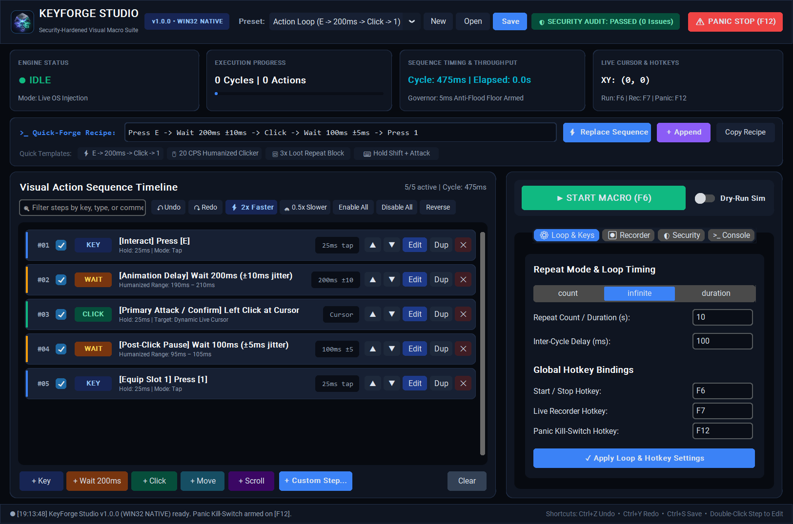
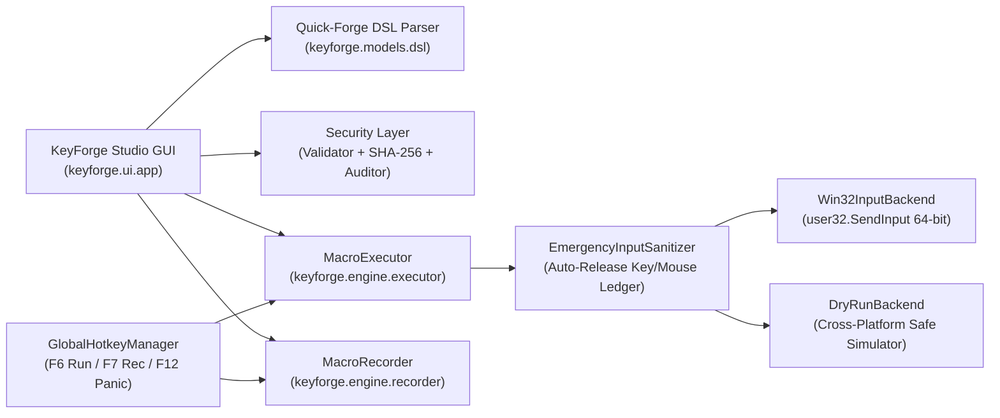

<div align="center">



# KeyForge Studio

**A Modern, Cybersecurity-Hardened, Free & Open-Source (FOSS) Visual Keyboard & Mouse Macro Builder, Recorder, and Auto-Clicker for Windows, macOS, and Linux.**

[](https://github.com/efeartn/KeyForge/actions/workflows/ci.yml)
[](https://github.com/efeartn/KeyForge/releases/latest)
[](https://github.com/efeartn/KeyForge/releases/latest)
[](pyproject.toml)
[](SECURITY.md)
[](LICENSE)

[**Download Standalone Binaries**](https://github.com/efeartn/KeyForge/releases/latest) • [**Quick-Forge DSL Guide**](#quick-forge-recipe-dsl-reference) • [**Cybersecurity Architecture**](#cybersecurity--safety-engineering) • [**CLI Reference**](#command-line-interface-cli)

</div>

---

## Live Studio Preview

<div align="center">
  
</div>

---

## Why KeyForge?

Anyone who uses auto-clickers, gaming macros, or desktop workflow automation constantly needs reliable repeat sequences such as:

```text
Press E -> Wait 200ms ±10ms -> Click -> Wait 100ms ±5ms -> Press 1
```

Until now, users were forced to choose between three flawed options:

| Feature / Guarantee | **KeyForge Studio (FOSS)** | **TinyTask (Abandoned)** | **AutoHotkey (Scripting)** | **Paid Macro Trialware** |
| :--- | :---: | :---: | :---: | :---: |
| **100% Free & Open Source (GPL-3.0)** | ✅ Yes | ❌ Closed binary | ✅ Yes | ❌ Trial timers / Paywalls |
| **Visual Step-by-Step Timeline Editor** | ✅ Full CRUD + Undo/Redo | ❌ Record-only blob | ❌ Code editor only | ⚠️ Often locked behind Pro |
| **Human-Readable One-Line Recipe Bar** | ✅ `Press E -> Wait 200ms -> Click` | ❌ No | ❌ Requires custom script | ❌ No |
| **Humanized Random Jitter (`±ms`)** | ✅ Built into every Wait step | ❌ Robotic fixed timing | ⚠️ Manual `Random()` code | ❌ Rare |
| **Auto-Release Stuck Keys on Abort** | ✅ `EmergencyInputSanitizer` | ❌ Leaves Shift/Ctrl stuck | ❌ Manual cleanup required | ⚠️ Unreliable |
| **Cryptographic Profile Verification** | ✅ SHA-256 + Static Auditor | ❌ Unverified binary blobs | ❌ Executes arbitrary code | ❌ Closed format |
| **Native Standalone Binaries** | ✅ Windows, macOS & Linux | ⚠️ Windows only | ⚠️ Windows only | ⚠️ Windows only |

---

## Download Prebuilt Standalone Executables

Every release is automatically tested, audited, and compiled by [GitHub Actions](https://github.com/efeartn/KeyForge/actions) into single-file executables with a published `SHA256SUMS.txt` integrity manifest:

| Operating System | Architecture | Standalone Binary | Checksum |
| :--- | :--- | :--- | :--- |
| **Windows 10 / 11** | `x64` | [**`KeyForge-Windows-x64.exe`**](https://github.com/efeartn/KeyForge/releases/latest/download/KeyForge-Windows-x64.exe) | [`KeyForge-Windows-x64.sha256.txt`](https://github.com/efeartn/KeyForge/releases/latest/download/KeyForge-Windows-x64.sha256.txt) |
| **macOS** | `Apple Silicon (arm64)` | [**`KeyForge-macOS-arm64`**](https://github.com/efeartn/KeyForge/releases/latest/download/KeyForge-macOS-arm64) | [`KeyForge-macOS-arm64.sha256.txt`](https://github.com/efeartn/KeyForge/releases/latest/download/KeyForge-macOS-arm64.sha256.txt) |
| **Linux** | `x86_64` | [**`KeyForge-Linux-x64`**](https://github.com/efeartn/KeyForge/releases/latest/download/KeyForge-Linux-x64) | [`KeyForge-Linux-x64.sha256.txt`](https://github.com/efeartn/KeyForge/releases/latest/download/KeyForge-Linux-x64.sha256.txt) |

---

## Core Studio Features

### 1. Visual Action Sequence Timeline
- **Color-Coded Step Cards**: Every action type (`KEY`, `WAIT`, `CLICK`, `MOVE`, `SCROLL`, `LOOP`) has a distinct neon accent stripe, semantic badge, technical subtitle, and right-aligned monospace metric pill.
- **Full Interactive Controls**:
  - **Double-Click Any Step** (or click `Edit`) to open the modal Step Inspector with live cursor coordinate capture (`Pick Current XY`).
  - **Undo / Redo History (`Ctrl+Z` / `Ctrl+Y`)**: 40-level snapshot history across all timeline edits, deletions, reorders, and recipe imports.
  - **One-Click Tempo Scaling (`⚡ 2x Faster` / `🐢 0.5x Slower`)**: Scale all wait durations and jitter across the entire macro (including nested repeat blocks) with a single click.
  - **Search & Bulk Actions**: Filter steps by key, type, or comment in real time; bulk enable/disable or reverse the entire sequence.

### 2. Quick-Forge Recipe DSL Reference
Type or paste human-readable macro recipes directly into the **Quick-Forge Recipe Bar** and press `Enter` (or click **⚡ Replace Sequence** / **+ Append**):

| Action | Quick-Forge Syntax Examples | Description |
| :--- | :--- | :--- |
| **Key Tap** | `Press E` • `Press Space` • `Press 1 (hold 40ms)` | Presses and releases a key with configurable hold time |
| **Modifier Combo** | `Press Ctrl+Shift+E` • `Press Alt+F` | Holds modifiers in order, taps primary key, releases in reverse |
| **Key Hold / Release** | `KeyDown Shift` • `KeyUp Shift` | Explicit key state transitions (auto-sanitized on stop) |
| **Mouse Click** | `Click` • `Click Right` • `DoubleClick Left at (640, 480)` | Single, double, down, or up click at live cursor or fixed `(X, Y)` |
| **Mouse Move** | `Move (500, 500)` • `Move (+120, -40) rel` | Absolute screen coordinates or relative pixel delta |
| **Mouse Scroll** | `Scroll -3` • `Scroll +5` | Vertical (`+Up` / `-Down`) mouse wheel scrolling |
| **Wait + Jitter** | `Wait 200ms` • `Wait 150ms ±20ms` • `Wait 1.5s` | High-precision interruptible sleep with optional humanization jitter |
| **Nested Repeat** | `Repeat 3 { Press F -> Wait 120ms ±15ms } -> Click` | Repeats an inner sequence `N` times inside the main macro loop |

### 3. Live Input Recorder (`F7`)
- Captures real-time keyboard and mouse actions directly into editable visual step cards.
- **Smart Tap Coalescing**: Automatically merges `KeyDown + KeyUp` pairs into clean `Press [Key] (hold Xms)` steps.
- **Anti-Echo Filtering**: Ignores synthetic OS events stamped with KeyForge's `0x4B465247` (`"KFRG"`) hardware tag as well as your configured control hotkeys (`F6`, `F7`, `F12`).

### 4. Hardware Panic Kill-Switch (`F12`) & Stuck-Key Sanitizer
- Pressing **`F12`** (or clicking **`⚠ PANIC STOP`**) aborts macro execution within **`< 5ms`** — even in the middle of a long `Wait 60s` step.
- **`EmergencyInputSanitizer`**: Tracks every depressed virtual key and mouse button in a thread-safe ledger and unconditionally dispatches matching `KeyUp` / `MouseUp` events in reverse order whenever a macro stops, aborts, or errors. **Your `Shift`, `Ctrl`, or mouse buttons can never get stuck down.**

---

## Cybersecurity & Safety Engineering

KeyForge is architected from the ground up with defensive security controls ([`SECURITY.md`](SECURITY.md)):

1. **Zero Arbitrary Code Execution (`No eval / exec / pickle`)**:
   - Macro profiles (`.kfmacro.json`) are strictly declarative JSON validated against an explicit allowlist of keys, types, and numeric bounds ([`keyforge/security/validator.py`](keyforge/security/validator.py)).
   - Rejects `NaN`/`Infinity` constants, boolean-as-integer confusion, path traversal, NTFS Alternate Data Streams (`:`), and Windows reserved device names (`CON`, `NUL`, `COM1`).
2. **Cryptographic SHA-256 Profile Signing**:
   - Saved profiles embed a canonical `integrity_sha256` digest verified via constant-time `hmac.compare_digest` ([`keyforge/security/integrity.py`](keyforge/security/integrity.py)) to detect tampering or corruption.
3. **Anti-DoS & "Billion Laughs" Loop Bomb Protection**:
   - Enforces hard complexity budgets (`MAX_PROFILE_BYTES = 1 MiB`, `MAX_TOTAL_STEPS = 5,000`, `MAX_NESTING_DEPTH = 5`, `MAX_EXPANDED_OPS_PER_CYCLE = 100,000`) and a **5ms minimum inter-cycle governor floor** so zero-delay infinite loops cannot starve the OS input queue.
4. **Built-in Static Security Auditor (`keyforge/security/auditor.py`)**:

| Rule Code | Severity | Security & Safety Check |
| :--- | :--- | :--- |
| **`KF-SEC-001`** | `WARNING` | Detects zero-wait infinite loops and confirms the `5ms` anti-flood governor is active |
| **`KF-SEC-002`** | `WARNING` | Detects unbalanced `KeyDown` / `MouseDown` actions without matching release steps |
| **`KF-SEC-003`** | `CRITICAL` | Detects suspicious shell/system invocation shortcuts (`Win+R`, `Win+X`, `Alt+F4`) — including split `KeyDown RWin -> Press R` evasion attempts |
| **`KF-SEC-004`** | `WARNING` | Flags extreme mouse click rates (`> 100 CPS`) that may trigger application rate-limiters |
| **`KF-SEC-005`** | `WARNING` | Flags empty sequences or profiles where all steps are disabled |

---

## Architecture Overview



### Repository Structure
```text
KeyForge/
├── .github/workflows/ci.yml      # Multi-OS Test, Audit, PyInstaller Build & Release Pipeline
├── keyforge/
│   ├── assets/                   # High-DPI App Icon (.png, .ico) & Studio Screenshot
│   ├── engine/
│   │   ├── backend.py            # InputBackend ABC, DryRunBackend & EmergencyInputSanitizer
│   │   ├── executor.py           # Interruptible High-Precision MacroExecutor & Telemetry
│   │   ├── hotkeys.py            # Global Hotkey Polling Thread (F6 / F7 / F12)
│   │   ├── recorder.py           # Live Input Recorder with Tap Coalescing & Self-Filter
│   │   └── win32_input.py        # Native 64-bit Win32 SendInput + Cross-Platform Fallback
│   ├── models/
│   │   ├── action.py             # MacroAction Dataclass, ActionType & Validation
│   │   ├── dsl.py                # Quick-Forge Recipe Parser & Formatter
│   │   ├── keymap.py             # Virtual-Key (VK) & Hardware Scan-Code Registry
│   │   └── profile.py            # MacroProfile & Built-In Presets
│   ├── security/
│   │   ├── auditor.py            # Static Security & Safety Analyzer (KF-SEC-001..005)
│   │   ├── integrity.py          # Canonical SHA-256 Signing & Constant-Time Verification
│   │   └── validator.py          # Allowlist Schema, Path & Complexity Budget Validator
│   ├── ui/
│   │   ├── app.py                # Modern Obsidian & Neon Studio Desktop GUI
│   │   ├── step_dialog.py        # Modal Step Inspector with Live XY Coordinate Picker
│   │   └── theme.py              # Studio Palette, Action Badges & Window Icon Loader
│   └── main.py                   # CLI & Desktop GUI Entry Point
├── scripts/build_exe.py          # Cross-Platform PyInstaller Compiler + SHA-256 Generator
└── tests/                        # Unit, Security, Engine, CLI & GUI Test Suite
```

---

## Installation & Quick Start

### Run from Source (Windows, macOS, Linux)
```bash
git clone https://github.com/efeartn/KeyForge.git
cd KeyForge
pip install -e ".[dev]"

# Launch the KeyForge Studio Desktop GUI
python -m keyforge
```

### Command-Line Interface (CLI)
KeyForge includes a full headless CLI for running quick recipes, auditing third-party profiles, or simulating macros in Dry-Run mode:

```bash
# Simulate a Quick-Forge recipe for 3 cycles in safe Dry-Run mode
python -m keyforge --expr "Press E -> Wait 200ms -> Click -> Press 1" --repeat 3 --dry-run

# Export the default SHA-256 signed macro profile
python -m keyforge --export-default my_combo.kfmacro.json

# Run the static cybersecurity & safety audit on a macro file
python -m keyforge --profile my_combo.kfmacro.json --audit

# Execute a saved profile using the live OS input engine
python -m keyforge --profile my_combo.kfmacro.json
```

### Compile a Standalone Binary Locally
```bash
pip install pyinstaller
python scripts/build_exe.py
# Produces dist/KeyForge-<OS>-<Arch>[.exe] + .sha256.txt checksum
```

---

## Running Tests & Linter

```bash
python -m pytest --cov=keyforge --cov-report=term-missing
python -m ruff check keyforge tests scripts
python -m ruff format --check keyforge tests scripts
```

---

## License & Security Policy

- **License**: Distributed under the [**GNU General Public License v3.0**](LICENSE).
- **Security Policy**: See [**SECURITY.md**](SECURITY.md) for threat model details and vulnerability reporting guidelines.
