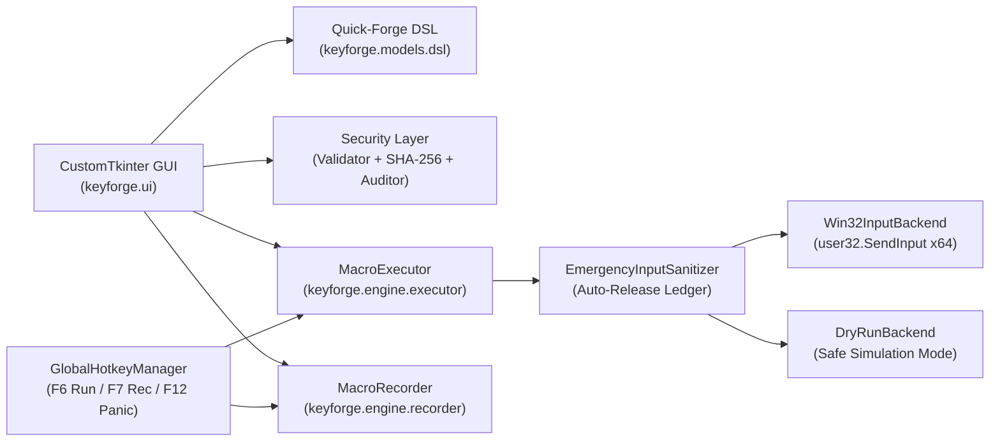

# ⚡ KeyForge

**A Modern, Security-Hardened, FOSS Visual Keyboard & Mouse Macro Builder, Recorder, and Auto-Clicker for Windows.**

[](LICENSE)
[](https://github.com/efeartn/KeyForge/actions)
[](pyproject.toml)
[](SECURITY.md)

---

## Why KeyForge?

People who use auto-clickers or game/productivity automation constantly need simple, reliable repeat loops — such as:

```text
Press E -> Wait 200ms -> Click -> Press 1
```

Until now, users were forced to choose between flawed alternatives:
1. **Abandoned Legacy Tools (TinyTask)**: Cannot edit individual steps after recording, cannot tweak a single delay or key, and provide no loop safety controls.
2. **Complex Scripting Languages (AutoHotkey)**: Require writing and debugging custom scripting syntax (`Loop`, `SendInput`, `Sleep`, `#MaxThreadsPerHotkey`) just to automate a 4-step sequence.
3. **Proprietary Trialware / Bloatware**: Paid macro utilities bundled with trial timers, paywalls, telemetry, or adware.

**KeyForge** solves this cleanly as a **100% Free and Open-Source Software (FOSS)** desktop application engineered with both **modern UX** and **cybersecurity-grade safety guarantees**.

---

## Key Features

### 1. Visual Step-by-Step Sequence Builder
- Build, reorder (`▲`/`▼`), duplicate, enable/disable, or edit individual steps visually:
  - **Key Press (`KEY`)**: Single keys (`E`, `1`, `Space`, `F1`–`F24`, Numpad, Arrows) or modifier combinations (`Ctrl+Shift+E`, `Alt+Tab`) with configurable hold duration (`ms`).
  - **Key Hold / Release (`KEY ↓` / `KEY ↑`)**: Explicit key state transitions.
  - **Mouse Click (`CLICK`)**: Left, Right, Middle, X1, X2 — Single click, Double-click, Button Down, or Button Up at either the **current live cursor** or **fixed `(X, Y)` screen coordinates** (with a one-click live `Pick Current XY` helper).
  - **Mouse Move (`MOVE`)**: Move cursor to absolute `(X, Y)` coordinates or relative `(±dX, ±dY)` pixel offsets.
  - **Mouse Wheel Scroll (`SCROLL`)**: Vertical and horizontal wheel scrolling.
  - **Wait + Humanized Jitter (`WAIT`)**: Exact millisecond delays with optional **`±ms` random humanization jitter** so repeat loops behave naturally instead of robotic lockstep.
  - **Nested Repeat Blocks (`LOOP`)**: Repeat sub-sequences `N` times inside a larger macro cycle.

### 2. Quick-Forge Recipe Bar (Human-Readable Shorthand)
- Type or paste a human-readable recipe directly into the top **Quick-Forge Bar**:
  ```text
  Press E -> Wait 200ms -> Click -> Press 1
  ```
  or advanced sequences:
  ```text
  Repeat 3 { Press F (hold 30ms) -> Wait 120ms ±15ms } -> Click Right at (640, 480)
  ```
- Click **Replace Sequence** or **Append Steps** to immediately generate visual step cards — or copy your visual steps as a single line of text to share with friends.

### 3. Live Input Recorder (`F7`)
- Record real-time keyboard and mouse actions directly into editable visual steps.
- Automatically coalesces `KeyDown + KeyUp` taps into clean `Press [Key] (hold Xms)` steps.
- Filters out KeyForge's own synthetic inputs (`0x4B465247` magic tag) and control hotkeys (`F6`, `F7`, `F12`) so recordings are never polluted.

### 4. Hardware Panic Kill-Switch (`F12`) & Stuck-Key Sanitizer
- Pressing `F12` at any time immediately aborts macro execution within `<5ms`.
- **EmergencyInputSanitizer**: Tracks every depressed key and mouse button in a thread-safe ledger and unconditionally dispatches matching `KeyUp` / `MouseUp` events on stop, abort, or error — **guaranteeing your Shift, Ctrl, or mouse buttons never get stuck down**.

### 5. Cybersecurity-First Design (`keyforge.security`)
- **Zero `eval()` / Zero Arbitrary Code Execution**: Macro files (`.kfmacro.json`) are strictly declarative JSON validated against an allowlist schema.
- **Cryptographic SHA-256 Profile Signing**: Every saved profile embeds a canonical `integrity_sha256` digest verified via constant-time `hmac.compare_digest` on load.
- **Static Security & Safety Auditor**: Automatically inspects profiles before execution for:
  - `KF-SEC-001`: Zero-delay infinite loops (with automatic `5ms` OS input queue flood protection).
  - `KF-SEC-002`: Unbalanced `KeyDown` / `MouseDown` holds.
  - `KF-SEC-003`: Suspicious shell/system shortcuts (`Win+R`, `Win+X`, `Alt+F4`) often abused in social-engineered macro files.
  - `KF-SEC-004`: Extreme click rates (`>100 CPS`).
- **DoS & "Billion Laughs" Protection**: Enforces strict caps on file size (`1 MiB`), step count (`5,000`), nesting depth (`5`), and expanded operations per cycle (`100,000`).

---

## Architecture Overview



---

## Installation & Quick Start

### Prerequisites
- **OS**: Windows 10 or Windows 11 (x64)
- **Python**: Python 3.10+

### Install & Run Desktop GUI
```powershell
git clone https://github.com/efeartn/KeyForge.git
cd KeyForge
pip install -e ".[dev]"

# Launch the KeyForge Desktop GUI
python -m keyforge
```

### Command-Line Interface (CLI) Usage
KeyForge also provides a full headless CLI for running expressions, auditing third-party profiles, or simulating macros in Dry-Run mode:

```powershell
# Simulate a Quick-Forge expression for 3 cycles in safe Dry-Run mode
python -m keyforge --expr "Press E -> Wait 200ms -> Click -> Press 1" --repeat 3 --dry-run

# Export the default signed macro profile
python -m keyforge --export-default my_combo.kfmacro.json

# Run static cybersecurity & safety audit on a macro file
python -m keyforge --profile my_combo.kfmacro.json --audit

# Execute a saved profile using the live Win32 SendInput engine
python -m keyforge --profile my_combo.kfmacro.json
```

### Building a Standalone Executable (`Windows .exe`, `macOS`, `Linux`)
KeyForge automatically compiles standalone binaries for **Windows (`KeyForge-Windows-x64.exe`)**, **macOS (`KeyForge-macOS-arm64`)**, and **Linux (`KeyForge-Linux-x64`)** on every push and release tag via [GitHub Actions](.github/workflows/ci.yml), complete with `SHA256SUMS.txt` checksums.

To compile locally on your machine:
```powershell
pip install pyinstaller
python scripts/build_exe.py
# Output binary + SHA-256 checksum in dist/
```

---

## Running the Test & Security Suite

```powershell
python -m pytest --cov=keyforge --cov-report=term-missing
python -m ruff check keyforge tests
```

---

## License

Released under the **MIT License**. See [LICENSE](LICENSE) and [SECURITY.md](SECURITY.md) for details.
